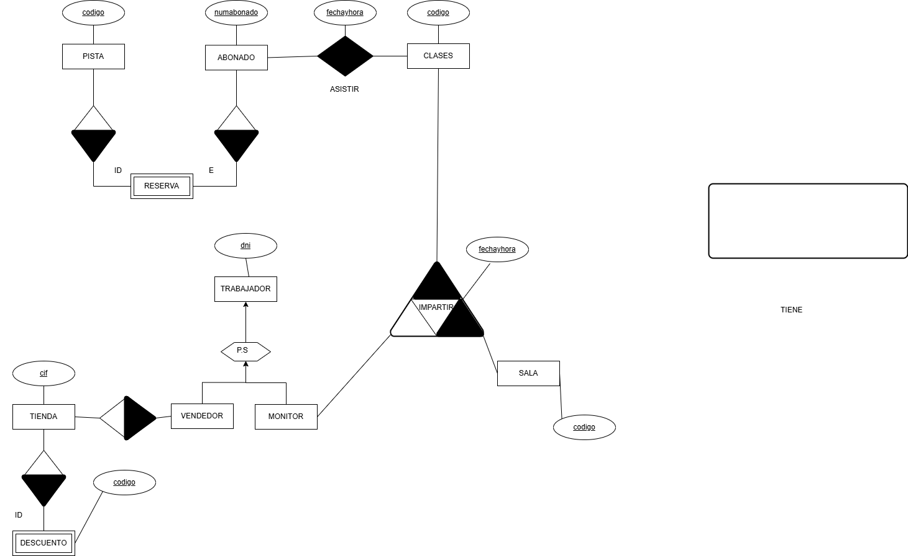

# 🗃️ Bases de Datos · Proyecto SQL

Proyecto completo de la asignatura **Bases de Datos** (3º curso) que cubre todo el ciclo de diseño e implementación de una base de datos relacional: desde el **modelo Entidad-Relación** hasta el script final en **Oracle SQL**.

## 🏛️ Caso de estudio

Gestión de un **club deportivo** que incluye:
- 🏢 **Salas** y **pistas** del club
- 👤 **Abonados** y **trabajadores**
- 🏋️ **Clases** impartidas
- 📅 **Reservas** y **asistencias**

## 📁 Estructura

```
Proyecto/
├── Enunciado.pdf            ← especificaciones del proyecto
├── diagramas/
│   ├── Diagrama-ER.png      ← diagrama Entidad-Relación
│   └── Diagrama-ER.drawio   ← fuente editable
└── scripts/
    ├── crearbd.sql          ← DDL: creación de tablas y restricciones
    └── datos.sql            ← DML: inserción de datos de prueba
```

## 🛠️ Tecnologías

- **Oracle SQL** (PL/SQL compatible)
- **drawio** para el modelado E-R
- Conceptos de modelado relacional

## 🎯 Conceptos aplicados

- Modelo Entidad-Relación (E-R)
- Paso de E-R a modelo relacional
- Diseño de claves primarias y foráneas
- Restricciones de integridad (`NOT NULL`, `UNIQUE`, `CHECK`)
- Normalización (1FN, 2FN, 3FN)
- Tipos de datos Oracle (`VARCHAR2`, `NUMBER`, `DATE`, `TIMESTAMP`)

## 🚀 Cómo ejecutar

Conéctate a una base de datos Oracle (SQL*Plus, SQL Developer, etc.) y ejecuta en orden:

```sql
@scripts/crearbd.sql
@scripts/datos.sql
```

## 📊 Vista previa del modelo



---

📌 *Proyecto del 3º curso del Grado en Ingeniería Informática — Universidad Miguel Hernández.*
